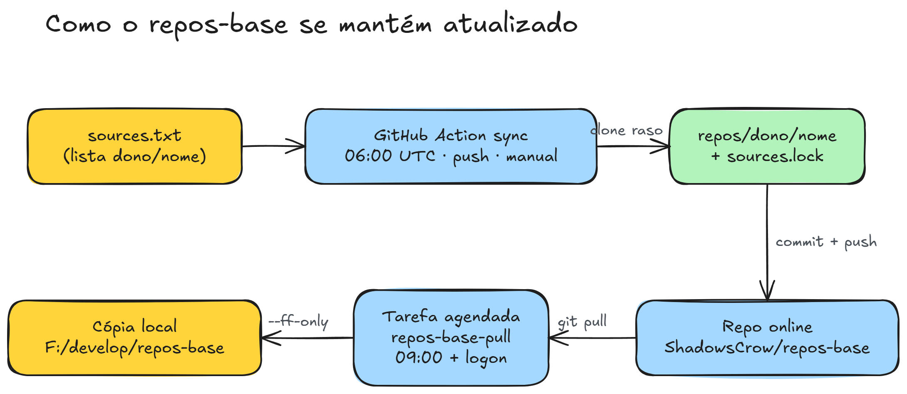

<div align="center">


</div>

<br/>

## 💡 A ideia

O **repos-base** é um acervo pessoal. Ele guarda os repositórios mais úteis que eu encontro e mantém todos na última versão, sem trabalho manual.

O resultado é um **kit de utilidades** que funciona offline: prompts, listas de APIs, ferramentas e referências, tudo numa pasta só. Uma automação roda todo dia e atualiza o acervo inteiro.

- **Uma lista, um acervo.** Eu adiciono `dono/nome` em `sources.txt`. O resto é automático.
- **Duas cópias.** Uma fica no GitHub e outra fica no meu computador. As duas se atualizam sozinhas.
- **Reprodutível.** O arquivo `sources.lock` guarda o commit exato de cada fonte.
- **À prova de sumiço.** Se uma fonte for apagada ou ficar privada, a última cópia continua aqui.

<br/>

## 🔄 Como funciona

<div align="center">
  
</div>

1. O GitHub Action `sync` lê `sources.txt`.
2. Para cada fonte, o script `scripts/sync.sh` faz um clone raso da última versão.
3. O script remove o `.git` e copia os arquivos para `repos/<dono>/<nome>`.
4. O script grava o commit exato em `sources.lock`.
5. O Action faz commit e push, só se algo mudou.
6. No meu computador, a tarefa agendada `repos-base-pull` roda `git pull --ff-only`.

| Quando | Quem roda | O que acontece |
|---|---|---|
| Todo dia às 06:00 UTC (03:00 em Brasília) | GitHub Action `sync` | Atualiza todas as fontes. |
| A cada push que altera `sources.txt` | GitHub Action `sync` | Sincroniza na hora uma fonte nova. |
| Botão **Run workflow** | GitHub Action `sync` | Atualização manual. |
| Todo dia às 09:00 e ao fazer logon | Tarefa `repos-base-pull` (Windows) | Traz as mudanças para o computador. |

<br/>

## 📦 O que tem no acervo

| Repositório | O que é | Licença |
|---|---|---|
| [yihui-dev/awesome-opus5-5-videos](https://github.com/yihui-dev/awesome-opus5-5-videos) | 703 prompts de vídeos feitos com o Claude Opus 5.5. É a base de todo vídeo que eu produzo. | MIT |
| [public-apis/public-apis](https://github.com/public-apis/public-apis) | Lista coletiva de APIs gratuitas. | MIT |
| [morluto/rea](https://github.com/morluto/rea) | Engenharia reversa com agentes, do comportamento de apps até binários nativos. | MIT |

Cada pasta em `repos/` mantém o arquivo de licença da fonte original.

<br/>

## ➕ Adicionar um repo

1. Confira o tamanho e a licença do repo.
2. Adicione `dono/nome` em `sources.txt`, uma fonte por linha.
3. Faça commit e push. O Action sincroniza na hora.
4. No computador, rode `git pull` ou espere a tarefa das 09:00.

```text
# sources.txt
yihui-dev/awesome-opus5-5-videos
public-apis/public-apis
morluto/rea
```

**Limites:**

- O script remove arquivos acima de 95 MB, porque o GitHub bloqueia arquivos acima de 100 MB.
- Repos muito grandes não cabem no acervo. Deixe esses repos fora.
- Linhas vazias e linhas com `#` são ignoradas.

<br/>

## 🗂️ Estrutura

```text
repos-base/
├── sources.txt          # lista de fontes (dono/nome)
├── sources.lock         # commit exato de cada fonte
├── repos/<dono>/<nome>  # cópia de cada fonte, sem .git
├── scripts/sync.sh      # baixa e copia as fontes
├── .github/workflows/
│   └── sync.yml         # automação diária
└── docs/                # diagrama deste README
```

<br/>

## 🛠️ Comandos úteis

```bash
# Atualizar o acervo agora, pelo GitHub
gh workflow run sync -R ShadowsCrow/repos-base

# Trazer a atualização para o computador
git pull --ff-only
```

<br/>

## ⚖️ Licenças

Os repositórios do acervo pertencem aos autores originais e seguem as licenças deles. Este repositório só guarda cópias para uso pessoal.
