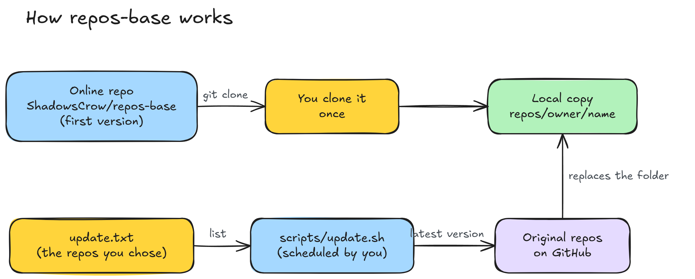

<div align="center">


</div>

<br/>

## 💡 The idea

**repos-base** is a collection of useful repositories. The online repository holds the **first version** of each one. After you clone it, **you choose** which repos your machine keeps up to date.

The result is a toolkit that works offline: prompts, API lists, tools and references, all in one folder.

- **Nothing runs on GitHub.** The online repository has no automation. It is only the starting point.
- **Updates by choice.** You list in `update.txt` the repos you want on the latest version.
- **Your own schedule.** You decide whether the script runs every day, every week or only on demand.
- **No size limit on your side.** The local update does not hit the 100 MB per file limit of GitHub.

<br/>

## 🔄 How it works

<div align="center">
  
</div>

1. You clone this repository once.
2. You copy `update.txt.example` to `update.txt` and keep only the repos you want to update.
3. The script `scripts/update.sh` downloads the latest version of each repo in the list.
4. The script replaces the folder `repos/<owner>/<name>` with the new version, without `.git`.
5. The script records the exact commit of each repo in `update.lock`.

Repos that are not in `update.txt` stay on the first version. The file `sources.lock` shows the commit of that first version.

<br/>

## 🚀 Getting started

```bash
git clone https://github.com/ShadowsCrow/repos-base.git
cd repos-base
cp update.txt.example update.txt
```

Edit `update.txt` and delete the lines of the repos you do **not** want to update. Then run:

```bash
bash scripts/update.sh              # updates the list in update.txt
bash scripts/update.sh --all        # updates every source in sources.txt
bash scripts/update.sh owner/name   # updates one repo only
```

> Requirements: `git` and `bash`. On Windows, use Git Bash.

<br/>

## ⏰ Automate it on your machine

**Windows:** create the scheduled task with the ready-made script. It runs every day at 09:00 and at logon.

```powershell
powershell -File scripts\schedule.ps1 -Time 09:00
```

**Linux and macOS:** add one line with `crontab -e`.

```cron
0 9 * * * cd /path/to/repos-base && bash scripts/update.sh >> update.log 2>&1
```

The log is in `update.log`. To stop the automation, remove the task or the cron line.

<br/>

## 📦 What is in the collection

| Repository | What it is | License |
|---|---|---|
| [yihui-dev/awesome-opus5-5-videos](https://github.com/yihui-dev/awesome-opus5-5-videos) | 703 prompts for videos made with Claude Opus 5.5. | MIT |
| [public-apis/public-apis](https://github.com/public-apis/public-apis) | A community list of free APIs. | MIT |
| [morluto/rea](https://github.com/morluto/rea) | Reverse engineering with agents, from app behavior down to native binaries. | MIT |

Each folder in `repos/` keeps the license file of the original source.

<br/>

## ➕ Add a repo

1. Check the size and the license of the repo.
2. Add `owner/name` to `sources.txt`, one source per line.
3. Add the same line to `update.txt` if you want your machine to update that repo.
4. Run `bash scripts/update.sh owner/name` to download the first copy.

Only repos that are in `sources.txt` can go in `update.txt`.

<br/>

## 🗂️ Structure

```text
repos-base/
├── sources.txt            # catalog: the repos the collection contains
├── sources.lock           # commit of the first version of each repo
├── update.txt.example     # template for your update list
├── update.txt             # your list (local, not tracked by Git)
├── update.lock            # commit of each local update (not tracked by Git)
├── repos/<owner>/<name>   # copy of each repo, without .git
├── scripts/
│   ├── update.sh          # updates the chosen repos
│   └── schedule.ps1       # creates the scheduled task on Windows
└── docs/                  # diagram used in this README
```

<br/>

## ⚠️ Cautions

- **Do not edit `repos/`.** An update replaces the whole folder of the repo and deletes your changes.
- **No history.** The copy is a snapshot without `.git`. To get the history of a source, clone it separately.
- **If a source disappears,** the clone fails and the previous copy stays as it is. The script prints a warning.

<br/>

## ⚖️ Licenses

The repositories in the collection belong to their original authors and follow their licenses. This repository only stores copies for personal use.

<br/>

<div align="center">

Made by [**ShadowsCrow**](https://github.com/ShadowsCrow)

⭐ If the collection helped you, leave a star on the repository.


</div>
